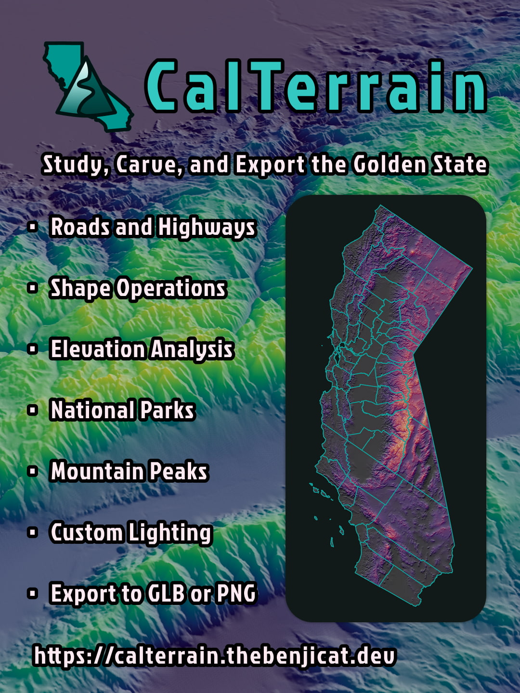

<a href="https://calterrain.thebenjicat.dev"></a>

# CalTerrain

CalTerrain is an interactive 3D California terrain viewer. It streams USGS elevation data and California GIS boundary data. Explore terrain, analyze features, create and edit shapes, and export clipped regions as PNG images or 3D models.

[Open CalTerrain](https://calterrain.thebenjicat.dev)

## Features

- **Explore terrain:** pan, rotate, and zoom around California; adjust vertical
  exaggeration, terrain palette, and lighting. Terrain data is streamed to keep high quality views with low memory usage.
- **View mapped features:** enable highways and interstates, mountain peaks,
  counties, and national parks and forests.
- **Create custom shapes:** add points, circles, rectangles, polygons, and
  polylines. Intersect, union, and subtract areas to create custom shapes.
- **Analyze and edit regions:** inspect area, perimeter, and line length; sample high and low terrain points; create elevation
  profiles of lines.
- **Export terrain:** mark regions with **CUT** and download as GLB or PNG

## Run the app

Requirements: [Bun](https://bun.sh/) and the generated terrain data in
`public/data`.

```sh
bun install
bun run dev
```

Open the local URL printed by Bun. Drag to pan, right-drag to rotate the camera,
and scroll or use the map controls to zoom. The camera can look straight down
at the map. Selecting a location focuses the view and displays its coordinates.

To create a production build and serve the app locally:

```sh
bun run build
bun run start
```

## Generate terrain data

Terrain generation requires GDAL and its Python bindings, NumPy, Pillow, USGS
GeoTIFF source rasters in `data_sources/USGS`, and the county archive
`data_sources/CA_Counties_simple.zip`. Install the native GDAL dependency and
Python packages, then run the pipeline:

```sh
brew install gdal
python3.15 -m venv .venv
source .venv/bin/activate
python -m pip install -r src/scripts/requirements-terrain.txt
bun run process:terrain
```

The GDAL Python package version must match the installed GDAL version. If
`gdal-config --version` is not `3.13.3`, update the GDAL pin in
`src/scripts/requirements-terrain.txt` before installing.

The pipeline derives the California boundary from the county polygons, writes
boundary and terrain data under `public/data`, generates lossless WebP
elevation tiles for zoom levels 8–11, and creates the precomputed
latitude/longitude grid. To cap the terrain generation zoom, run the Python
script directly, for example:

```sh
python src/scripts/process_terrain.py --max-zoom 9
bun run generate:grid
```

To regenerate only the county-derived California boundary:

```sh
python src/scripts/create_california_boundary.py
bun run generate:grid
```

The browser loads generated files from `/data/...`, served from `public/data`.
Raw USGS rasters remain in `data_sources` and are not copied into the browser
bundle.

## Test and build

```sh
bun test
bunx tsc --noEmit
bun run build
```

Run a focused test file with `bun test path/to/file.test.ts`.

## GitHub Pages

The GitHub Actions workflow builds and deploys the site to GitHub Pages on
every push. In the repository settings, enable Pages with **GitHub Actions** as
the build and deployment source.
